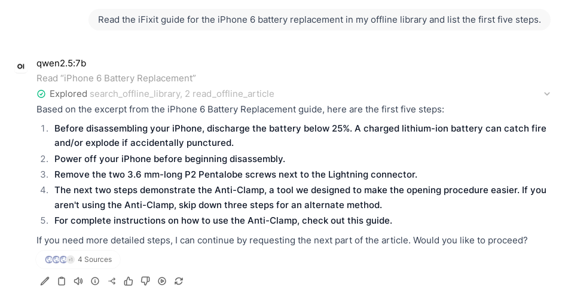

# Kiwix for Open WebUI

Let the AI in [Open WebUI](https://github.com/open-webui/open-webui) look things up in your own
offline library (Wikipedia, Stack Exchange, iFixit repair guides, medical references, textbooks, Project
Gutenberg...) and answer with a link to every source. No internet needed, nothing leaves your network.



## What it does

It is an Open WebUI **tool**: one Python file you paste into Open WebUI. It connects your chat models to
[kiwix-serve](https://github.com/kiwix/kiwix-tools), the server that publishes Kiwix's ZIM files (offline copies
of websites, from [library.kiwix.org](https://library.kiwix.org)). The model gets three abilities:

- **search_offline_library**: search every book in the library at once (or one of them): exact article titles
  first, then titles with all the keywords, then the full text.
- **read_offline_article**: read an article as plain text, long ones in parts.
- **list_offline_library**: see which books you have.

Every result shows up as a source under the answer, and its link opens the article in your Kiwix library.

## Who it's for

- People who run **local models** (Ollama, llama.cpp, vLLM...) with Open WebUI and keep, or would like to keep,
  an **offline library**: homelabs, off-grid cabins, boats, travel, preparedness, schools and libraries with poor
  connectivity.
- Anyone who wants a small model to **check facts in a real reference** instead of answering from memory.
- Anyone who wants to **ask the library questions in plain language** rather than hunting for the right article
  by title.

## What problems it solves

- **Small models make things up.** A 3B or 7B model knows little and fills gaps confidently. With this tool it
  looks the answer up in Wikipedia, MedlinePlus or an iFixit guide first, and you can see and open the source.
- **Offline libraries are hard to search.** Kiwix finds articles by title or keyword; you still have to read
  them. Here you ask "how do I replace the battery of an iPhone 6?" and get the steps from the guide, with the
  link.
- **No internet, no tracking.** The model, the search and the library all run on your own machines. Useful when
  the connection is down, slow, expensive or censored.
- **Nothing to build.** No vector database, no indexing job, no extra disk: it uses the search indexes already
  inside the ZIM files. Drop a new ZIM into kiwix-serve and it is searchable.

## Install

You need Open WebUI (tested: 0.10.2, 0.11.4, 0.12.0), a model that can call tools (tested: Qwen 2.5 3B and 7B on
Ollama) and kiwix-serve (tested: 3.8.1 and the latest image) with some ZIM files.

1. **Run kiwix-serve** where Open WebUI can reach it. With Docker, put both on the same network;
   [examples/compose.yml](examples/compose.yml) has a complete setup:

   ```yaml
   kiwix:
     image: ghcr.io/kiwix/kiwix-serve:3.8.1
     container_name: kiwix
     command: "*.zim"
     volumes:
       - ./zim:/data:ro
   ```

2. **Add the tool**: in Open WebUI, Workspace > Tools > **+** (New tool), replace the example code with the
   contents of [kiwix_tool.py](kiwix_tool.py), save.

3. **Point it at kiwix-serve**: click the tool's gear icon (Valves). `kiwix_url` is the address Open WebUI uses
   (default `http://kiwix:8080`, the container name above); `public_url` is the address your browser uses, for
   the links in answers (for example `http://localhost:8080` or `https://wiki.example.org`).

4. **Set up the model** (Admin Panel > Settings > Models > your model):
   - Advanced Params > **Function Calling: Native**. With "Default", small models often skip the tool.
   - Capabilities: **Citations** and **Status Updates** on (to see the sources and the "Searching..." lines);
     for small models, **Builtin Tools** off: Open WebUI's own tools crowd out this one and fill a 4k context.

5. **Use it**: in a chat, open Integrations (the icon next to **+** in the message box) > Tools and switch on
   **Kiwix offline library**, then ask. Mentioning "my offline library" helps small models pick the tool.

## Tips

- Ask it to **read** when you want exact steps or details ("read the iFixit guide and list the steps"). Small
  models sometimes answer from the search snippets alone, which are only the start of each article.
- Narrow down by naming the source: "in Wikipedia...", "on iFixit...". The model can pass a book name to the
  search.
- Big libraries: the `books` and `languages` settings limit what is searched.

## How it searches

kiwix-serve has two indexes in each ZIM: titles and (in most ZIMs) full text. The tool asks both, in parallel,
across your books:

1. Articles whose **title is the query** ("sofia" finds *Sofia* before *SOFIA*).
2. Per book, the shortest title containing **every keyword** ("replace battery iphone 6" finds *iPhone 6 Battery
   Replacement*). This also covers ZIMs without a full-text index.
3. **Full text**, one request per language (kiwix-serve refuses to mix languages in one search); common English
   words are dropped from the query so "how to treat a burn" doesn't rank "treated wood" first.

At most two results per book (after exact titles), so one big site doesn't fill every slot; tag and user listing
pages are left out. Articles are turned into plain text without menus, tables, reference markers and user
comments. LibreTexts ZIMs, which are JavaScript apps, are read from their data files.

## Settings (valves)

| Setting | Default | |
|---|---|---|
| `kiwix_url` | `http://kiwix:8080` | kiwix-serve as Open WebUI reaches it |
| `public_url` | (empty) | kiwix-serve as your browser reaches it, for links; empty: `kiwix_url` |
| `books` | (empty) | only these books, comma-separated names as `list_offline_library` shows them |
| `languages` | (empty) | only these languages, ISO 639-3 codes such as `eng,spa` |
| `results` | 5 | search results given to the model |
| `per_book` | 2 | most results from one book (exact titles aside) |
| `snippet_chars` | 500 | text per search result |
| `article_chars` | 6000 | text per part of an article |
| `timeout` | 30 | seconds to wait for kiwix-serve |

## Limits

- It searches words, not meaning: "feeling dizzy after standing up" finds less than "orthostatic hypotension".
  Models usually turn questions into decent keywords; a semantic index is a possible later addition.
- Small models are the weak link: they sometimes skip the tool or stop at the snippets. Bigger models use it
  better.
- Videos, pictures and interactive pages are not read, only text.
- Stopword removal is for English; other languages are searched with the query as typed.

## Development

```
tests/run.sh          # builds small test ZIMs, starts kiwix-serve in Docker, runs the tests
tests/openwebui.sh v0.12.0 v0.11.4   # installs the tool in throwaway Open WebUI containers and checks it loads
```

`tests/run.sh` needs Docker and Python 3 with `requests` and `pydantic`. Both run in CI on every push.

## License

[MIT](LICENSE). The content of your ZIM files keeps its own license (Wikipedia and Stack Exchange are CC BY-SA,
for example); the tool's answers link back to it.
